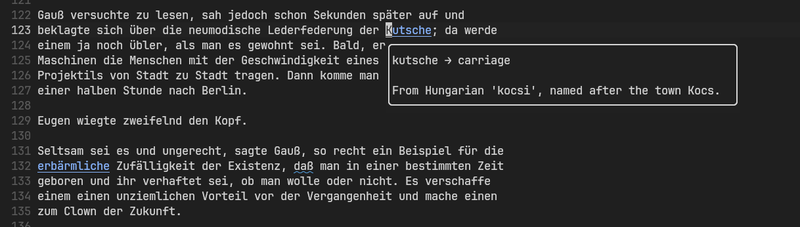

# ZehnTage

Only ten days to learn German vocab? ZehnTage ("ten days" in German) is a Neovim plugin that shows word definitions with memorization notes, and automatically pushes them to Anki via the anki-mcp server.



## Installation

LazyVim(recommended):

```lua
{
    "30be/zehntage",
    opts = {}, -- provider/model selection goes here, see below.
    ft = { "markdown", "text" },
    keys = {
        { "K", "<cmd>ZehnTage<CR>", desc = "ZehnTage add word" }, -- the same as hinting is often set up
        { "<leader>zc", "<cmd>ZehnTageClear<CR>", desc = "ZehnTage clear word" },
        { "K", ":ZehnTageTranslate<CR>", desc = "ZehnTage translate selection", mode = "v" },
        { "<leader>zo", "<cmd>ZehnTageOpus<CR>", desc = "ZehnTage ask Opus", mode = { "n", "v" } },
    },
},
```

By default it uses **Claude Haiku 5.5** (thinking off) for the instant answer,
and **Opus** through the local Claude Code CLI (`claude -p`, your subscription)
as a second opinion: it is prefetched on every lookup, Anki cards are built from
it, and `:ZehnTageOpus` (`<leader>zo`) shows it for the word under the cursor or
the selection. Set `ZEHNTAGE_ANTHROPIC_API_KEY` (or `ANTHROPIC_API_KEY`, but
that one also moves Claude Code itself to API billing) and have `claude` logged
in. `opts = { opus = false }` turns the Opus half off; `opts = { model =
"claude-opus-5-5" }` makes Opus (low effort, over the API) the answer model
itself, which also turns the CLI half off.

## Provider / model

Pick a different provider and/or model via `opts`:

```lua
opts = {
    provider = "gemini", -- "gemini" | "groq" | "claude" (default) | "cerebras"
    model = "gemini-2.5-flash", -- optional; each provider has its own default
},
```

Each provider reads its key from its own environment variable:

| provider | default model | env var |
|---|---|---|
| `gemini` | gemini-3.5-flash-lite | `GEMINI_API_KEY` |
| `groq` | openai/gpt-oss-120b | `GROQ_API_KEY` |
| `claude` | claude-haiku-5-5 | `ZEHNTAGE_ANTHROPIC_API_KEY` |
| `cerebras` | zai-glm-4.7 | `CEREBRAS_API_KEY` |

The entire plugin is a single file: [lua/zehntage.lua](lua/zehntage.lua).

The initial prompt is [included](PROMPT.md) (Claude Opus 4.6).

## Translate

Select text in visual mode and run `:'<,'>ZehnTageTranslate` (or press `K` in visual mode with the config above) to translate without memorizing the word or creating an Anki card.

## Anki sync

Learned words live on a remote `anki-mcp` server, which is the source of truth for the word list. On startup the plugin fetches the list from the server; every `:ZehnTage` pushes a new card automatically (Opus's answer once it arrives), and `:ZehnTageClear` removes it.

Set two environment variables:

- `ZEHNTAGE_ANKI_URL` — base URL of the anki-mcp server (a trailing `/mcp` is stripped automatically).
- `ZEHNTAGE_ANKI_KEY` — the secret key, sent as the `X-Zehntage-Key` header.

If either variable is unset, the plugin still translates words normally — it just skips the server calls and notes this in the popup.
